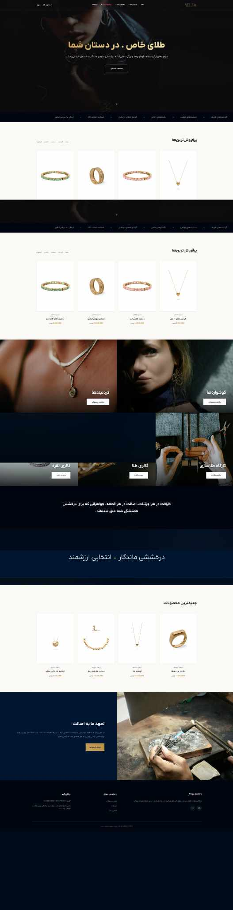

# Velza Gallery

**Gold & Jewelry Retail Website · Client Project Portfolio Case Study**

**Live website:** [velza-gallery.com](https://velza-gallery.com/)

## Overview

Velza Gallery is a Persian-language, right-to-left website for a gold and jewelry brand. The homepage combines a dark navy-and-gold visual identity, editorial photography, jewelry collections, and product-led browsing.

The archived full-page screenshot documents:

- A full-width editorial hero and shopping call to action
- Best-selling jewelry products with photos and displayed prices
- Category navigation for necklaces, earrings, and related jewelry collections
- Collection and jewelry-workshop promotional areas
- A new-products section and an editorial section focused on craftsmanship

## My Contribution

- Website design and visual presentation for the jewelry brand
- Responsive-oriented homepage structure and product presentation
- Persian RTL storefront layout and category organization
- Collection banners, product cards, and brand-focused content hierarchy

## Technologies / Focus

- Persian RTL Interface
- Jewelry Product Catalog Presentation
- Product and Collection Discovery
- Visual Design and Responsive Layout

**Scope of verification:** The screenshot supports the appearance and visible content described here. The CMS, programming stack, checkout/payment integration, customer accounts, and performance metrics have not been independently verified and are not claimed.

## Source Code

This repository contains a portfolio case study and an archived website screenshot. It does **not** publish the client's production source code, configuration, credentials, or database.

## Portfolio Note

The image above was supplied by the portfolio owner as a complete homepage capture dated 31 October 2026. The live website may change after delivery; the archived capture documents the version presented here.

## Rights & Attribution

The brand name, trademarks, jewelry photography, product images, and other third-party assets belong to their respective owners. This material is included only to document professional website work.
